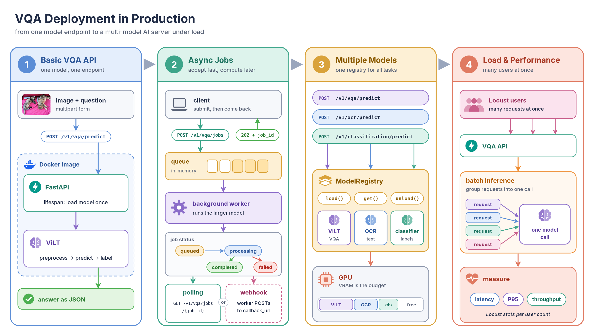

# VQA Deployment in Production

This repo takes a Visual Question Answering (VQA) model from a single API endpoint to a small production-style
AI server. You send an image and a question in English, and the server returns a short answer.
The code is kept short and flat on purpose: each file can be read top to bottom.



## What you will learn

- **01 - Basic VQA API**: load ViLT once in the FastAPI `lifespan`, serve `POST /v1/vqa/predict`
  (image upload + question form field) with Pydantic schemas and input validation, and package it with Docker.
- **02 - Async jobs**: switch to a larger, slower model (BLIP) and add a job API: `POST /v1/vqa/jobs` returns
  `202 Accepted`, the client polls `GET /v1/vqa/jobs/{job_id}`, and an optional webhook is called when the job is done.
  One background worker thread reads jobs from a queue.
- **03 - Multi-model server**: serve VQA, OCR and image classification from one process through a small
  `ModelRegistry`, and compare loading every model at startup with lazy loading on the first request.
- **04 - Load testing**: load-test the sync and job APIs with Locust (average latency, P95, throughput, failures),
  sample GPU usage with `nvidia-smi`, and measure how batch size changes throughput.

## Repository structure

```
.
├── 01-basic-vqa-api/    # app.py, schemas.py, client.py, Dockerfile
├── 02-async-jobs/       # app.py, worker.py, client_poll.py, webhook_receiver.py, compare_latency.py, Dockerfile
├── 03-multi-model/      # app.py, registry.py, models/{vqa,ocr,classify}.py, client.py, Dockerfile
├── 04-load-testing/     # locustfiles, run_locust.sh, gpu_monitor.sh, batch_benchmark.py, app_batch.py
├── samples/             # test images shared by all parts
└── assets/              # README figure
```

Each part is self-contained: it has its own `requirements.txt` and README, and only adds one new idea on top of
the previous part.

## Requirements

- Python 3.10 or newer (the Docker images use Python 3.11)
- Docker, for the Dockerfiles in parts 01-03
- Optional: an NVIDIA GPU. Everything also runs on CPU, just slower.
- Internet access on the first run: the models are downloaded from the Hugging Face Hub and cached in
  `~/.cache/huggingface`.

## Installation

```bash
git clone https://github.com/dangnha/vqa-deployment-in-production.git
cd vqa-deployment-in-production
python3 -m venv .venv
source .venv/bin/activate
pip install -r 01-basic-vqa-api/requirements.txt   # use the requirements.txt of the part you want to run
```

## Quickstart

Every API runs from its own folder on port 8000:

```bash
cd 01-basic-vqa-api
uvicorn app:app --host 0.0.0.0 --port 8000   # terminal 1
python client.py                             # terminal 2
```

Interactive docs (Swagger UI): http://localhost:8000/docs

To run the same API in Docker:

```bash
cd 01-basic-vqa-api
docker build -t vqa-part1 .
docker run --rm -p 8000:8000 -v ~/.cache/huggingface:/root/.cache/huggingface vqa-part1
# add --gpus all to use the GPU (needs the NVIDIA Container Toolkit)
```

See each part's README for its own commands:
[01](01-basic-vqa-api/README.md) · [02](02-async-jobs/README.md) ·
[03](03-multi-model/README.md) · [04](04-load-testing/README.md)

## Models

| Part | Task | Model |
|---|---|---|
| 01, 03, 04 | VQA | `dandelin/vilt-b32-finetuned-vqa` |
| 02 | VQA (slower) | `Salesforce/blip-vqa-capfilt-large` |
| 03 | OCR | `microsoft/trocr-small-printed` |
| 03 | Classification | `google/vit-base-patch16-224` |

## Sample images

- `coco_000000039769.jpg` (two cats on a couch), `coco_000000000139.jpg` (living room),
  `coco_000000000632.jpg` (bedroom): from the COCO 2017 validation set (https://cocodataset.org),
  Flickr photos under Creative Commons licenses, used here for teaching.
- `sign_text.png`: a printed text strip ("OPEN 24 HOURS") for the OCR endpoint.
- `not_an_image.txt`: a text file to show the `400` validation error.
